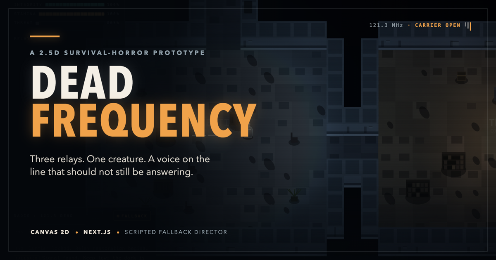
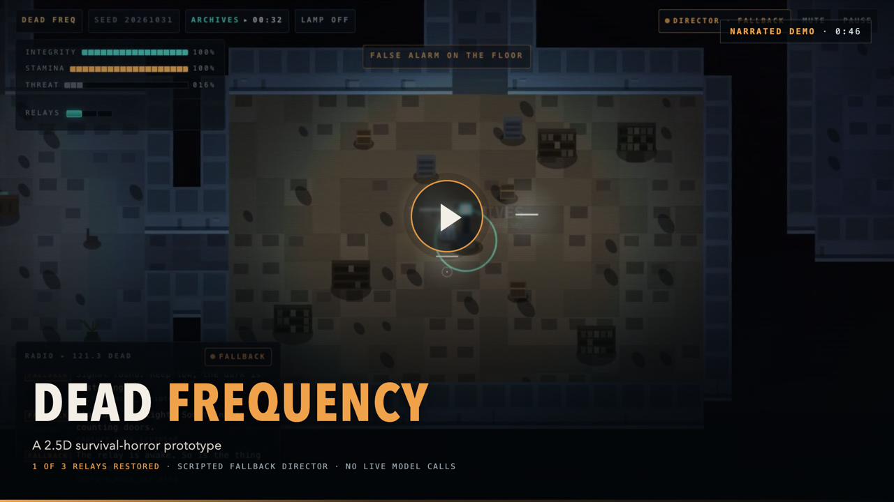

# Dead Frequency

A short 2.5D survival-horror game about an abandoned facility and an emergency
operator that should not still be answering. Restore three relays, avoid the
creature, and decide whether to release the voice or shut it down.



**Repository:** [puri-adityakumar/dead-frequency](https://github.com/puri-adityakumar/dead-frequency)
(private). This is a playable local prototype with a scripted fallback director,
not a deployed game or a live-model demonstration.

## In this game

- One seeded facility with five rooms, three relays, and one pursuing creature.
- Wall-clipped flashlight, room fixtures, relay glow, and procedural sound.
- Desktop and touch controls, pause/restart, death, and two ending choices.
- A bounded optional director adapter. No API key is needed for scripted play.

## Stack

- Next.js, TypeScript, React, and Canvas 2D. There is no 3D engine.
- Original procedural graphics and Web Audio, with no remote art or font assets.
- A same-origin `/api/director` endpoint for Tinker inference. The model selects
  bounded haunting events at milestones, not movement or collision each frame.
- Scripted fallback when live inference is unavailable, labelled as fallback.

## Run locally

Use Node.js 24 LTS and npm.

```sh
git clone https://github.com/puri-adityakumar/dead-frequency.git
cd dead-frequency
npm ci
npm run dev
```

Open <http://localhost:3000>. No API key is needed to play the scripted prototype.
Cloning the private repository requires access to the GitHub account or a
collaborator invitation. For a local production run, use `npm run build` followed
by `npm start`.

### Controls

| Action | Control |
| --- | --- |
| Move | WASD or arrow keys |
| Aim | Mouse |
| Sprint | Shift |
| Interact | E |
| Toggle flashlight | F |
| Pause | Escape or the pause button |

Touch devices have on-screen controls. Audio starts only after a user gesture;
the interface includes a mute control.

## Optional live Tinker director

See [Tinker setup](docs/TINKER.md) for the complete integration requirements.
The server needs `TINKER_API_KEY` and `TINKER_MODEL_PATH`, which must point to a
real sampler checkpoint. A key alone is not a configured live director.

Use the variable names in `.env.example` for a local `.env.local` file or set
them in the hosting environment. Never put the key in a `NEXT_PUBLIC_` variable,
client code, a screenshot, or a commit. Rotate any key previously shared in chat.

Requests contain compact game telemetry and a bounded recent radio history, not
personal information. The server validates both input and model output, limits
request size and frequency, and falls back on errors. No model-generated code is
executed. The model cannot directly kill or teleport the player or permanently
block progression.

The in-memory request limiter is local to each server process, not a global
billing limit. Add provider-side spending controls and a shared limiter before
opening live inference to significant public traffic.

## Checks

```sh
npm test
npm run typecheck
npm run build
npm run test:blog
```

Unit tests do not require a real key and mock upstream inference. Building the
app does not start training or call a paid model. Training and live inference
remain a separate, budget-approved step.

With the app running in a separate terminal and a local Chrome installation:

```sh
npm run test:smoke -- http://localhost:3000

# Isolated renderer checks, no server needed
npm run test:lighting
```

Browser smoke checks mock the director endpoint, so they do not spend Tinker
credits. See [QA instructions](docs/QA.md) for browser configuration and coverage.

Verified locally: **56 unit tests**, TypeScript, production build, **14 isolated
lighting scenes**, and **27 post-lighting Chrome smoke checks**, with no
failures, warnings, or skips.
The production standalone API also returned an honest fallback without Tinker
configuration and rejected a foreign Origin. Relays, death, and both endings
have simulation coverage, but were not reached by the short browser smoke run.
Live Tinker inference, fine-tuning, and Render deployment remain unverified.

Lighting scenes exercise all five rooms with the flashlight off/on and all
three relay rooms restored. They check readable shadows, visible beam changes,
and a brighter room after restoration. An open exit gate and a directional beam
probe have separate coverage. These are renderer fixtures, not a recorded
playthrough.

## Blog and demo media

- [Local article draft](blogs/dead-frequency-ghost-in-the-machine.md), inspired
  by Raincheck's screenshot-led writeup format, with original prose.
- [Narrated gameplay demo](blogs/assets/video/dead-frequency-demo.mp4), 46.4
  seconds, real controls and one restored relay. Director responses are mocked
  as fallback. Microsoft Edge `en-US-AndrewNeural` narration replaces game
  audio, with no music, electronic drone, or background bed.
- [Lighting comparison](blogs/assets/video/lighting-demo.mp4), 12 seconds,
  silent labelled renderer fixtures, not gameplay.
- [Screenshots and media manifest](blogs/README.md), with capture notes,
  transcript, captions, cover, and an illustrative architecture diagram.

Run `npm run test:blog` to check the local article's asset references. The draft
is unpublished, the repository is private, and no app license has been chosen.
Before publishing on DEV, replace relative media paths with public URLs or
uploaded assets. The clips do not show a full playthrough, death, or endings.

### Watch the demo

[](blogs/assets/video/dead-frequency-demo.mp4)

[English captions](blogs/assets/video/dead-frequency-demo.srt) ·
[Narration transcript](blogs/assets/video/narration.txt) ·
[Capture notes and limitations](blogs/assets/media-notes.md)

### Regenerate the narration (optional)

The delivered video already contains speech. Playback needs no Python or TTS
service. To regenerate it, install Python 3.12+, `uv`, and FFmpeg/ffprobe, then:

```sh
uv venv --python 3.12 .venv
uv pip install --python .venv/bin/python edge-tts==7.3.1
.venv/bin/python scripts/narrate-demo.py --voice en-US-AndrewNeural --yes
```

This optional command sends the fixed, nonpersonal narration text to Microsoft's
online Edge speech service. It is not offline speech, live game inference, or
an Azure subscription API. It replaces only the demo soundtrack, preserves the
encoded video stream, and rewrites captions from the synthesized speech timings.
Raw speech and verification reports stay in ignored `test-results/narration/`.

## Project map

| Path | Contents |
| --- | --- |
| `src/game/` | Seeded map, simulation, creature navigation, input, lighting, Canvas renderer, and [engine design](src/game/DESIGN.md) |
| `src/components/` | React shell, HUD, overlays, radio, touch controls, and director client |
| `src/audio/` | Gesture-gated procedural Web Audio |
| `src/app/api/director/` | Same-origin route for the bounded director |
| `src/lib/director/` | Validation, policy, limits, optional Tinker adapter, and fallback |
| `src/shared/contracts.ts` | Engine, UI, and director types and units |
| `tests/` | 56 unit and integration tests |
| `scripts/` | Browser smoke, lighting checks, blog validation, media capture, and optional Microsoft narration |
| `blogs/` | Complete article draft, six screenshots, cover, diagram, recordings, captions, and transcript |
| `docs/` | [QA](docs/QA.md), [Tinker setup](docs/TINKER.md), and [implementation plan](docs/IMPLEMENTATION_PLAN.md) |
| `render.yaml` | Optional deployment blueprint, not an active deployment |

The repository includes source, the lockfile, configuration, tests, docs, and
the delivered blog/media package. It deliberately excludes real credentials,
`node_modules/`, `.next/`, raw captures and scratch scripts in `test-results/`,
local logs/cache files, and the supplied unlicensed `skills/dark-sector/`
reference archive. `.env.example` contains blank configuration placeholders.

## Deploy to Render

The included `render.yaml` describes one Node web service. It builds the Next.js
standalone server and copies the static client assets alongside it. Deployment
is not automatic; create a Render Blueprint from your repository when ready.

Without Tinker environment variables, the deployment uses scripted fallback.
When a checkpoint is ready, add the two server-only variables in Render, without
placing their values in `render.yaml`. A model timeout does not pause the game.

## Challenge status and attribution

This project targets the DEV Hacktoberfest Week 4 **Ghost in the Machine** theme.
The supplied Dark Sector skill informed the concept. Its source is not copied
into the application because the supplied archive has no explicit redistribution
licence. The reference archive under `skills/` is not required to build or deploy
the game; do not redistribute it without confirming permission.

The prototype is not evidence of a Tinker fine-tuning result. That prize category
requires actual fine-tuning and a measured improvement over an untuned baseline
on held-out examples. Render category use requires an actual deployment, not
merely the configuration file in this repository.

For the challenge entry, include the code repository, demo, open-AI explanation,
and only the partner categories actually used. Disclose any changes made after
the submission deadline in this README.

OpenCode was used as an open-source coding harness during development. That
alone does not establish the challenge's AI-at-the-core requirement: the
current game director is scripted fallback, not a live open-weight model.
The article draft is not a published or submitted entry.

## Handoff status

Repository packaging update dated **2026-11-01**: finalized README and repository
links, included the completed blog/media, and excluded ignored capture scratch
files from TypeScript checks. The typecheck command generates Next.js route
types so it also works before the first build. This packaging pass did not
change gameplay.
Audio revision dated **2026-11-01**: replaced the original macOS voice and
synthetic background bed with Microsoft Andrew Neural speech only. Footage,
duration, poster, and the silent lighting comparison are unchanged; sixteen
sentence-level caption cues follow the new speech timings. This revision
updates the repository media, not a deployment or DEV publication.
The challenge deadline is October 31, 2026, 11:59 PM PDT (November 1, 12:29 PM
IST); any changes after that cutoff must be disclosed rather than presented as
part of a previously submitted build.

Still not done: a public release and license choice, hosting the game, publishing
the DEV article, any challenge submission, live Tinker inference, training, or
baseline-versus-tuned evaluation. No paid model use is implied by this repository.
