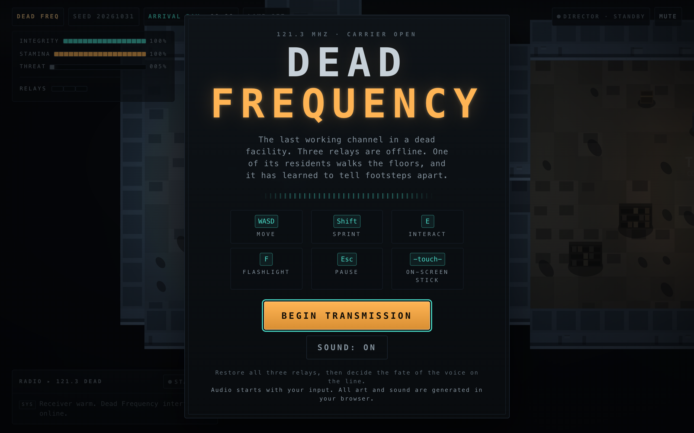
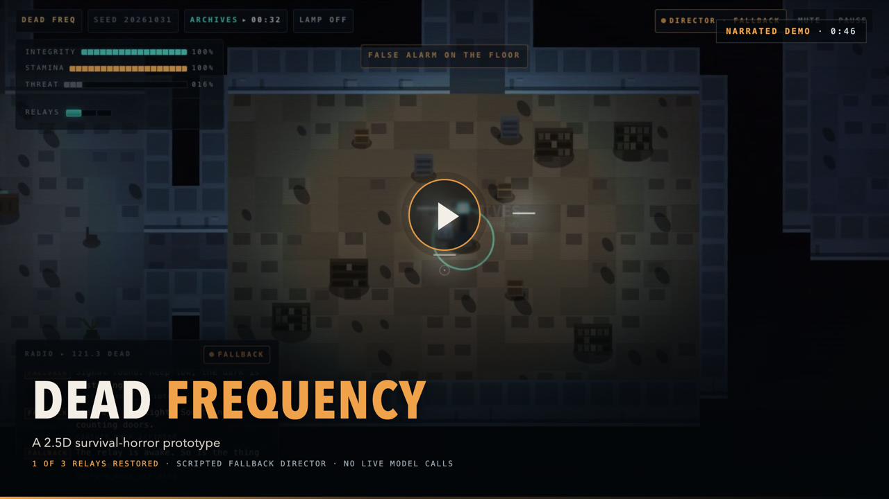
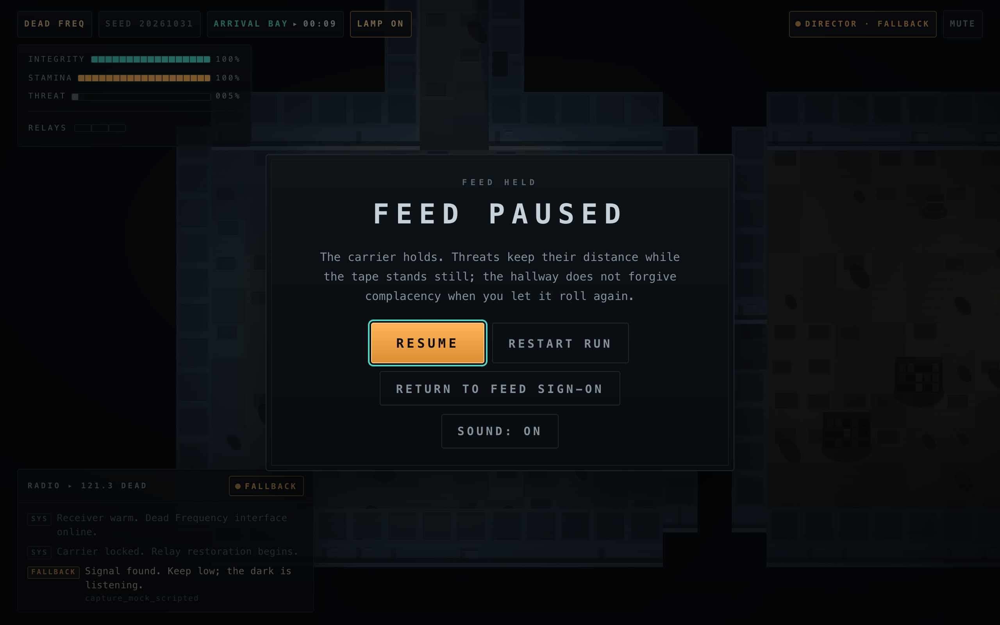
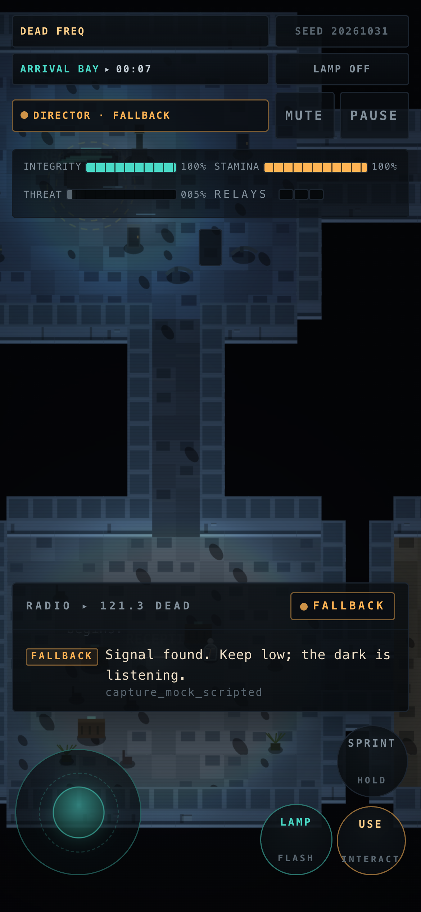
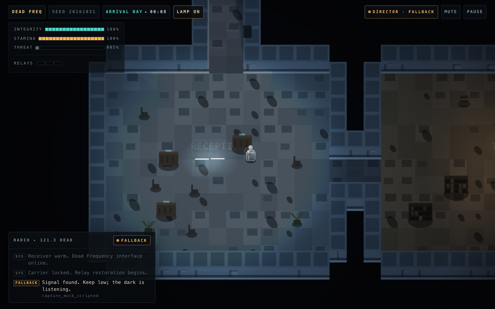
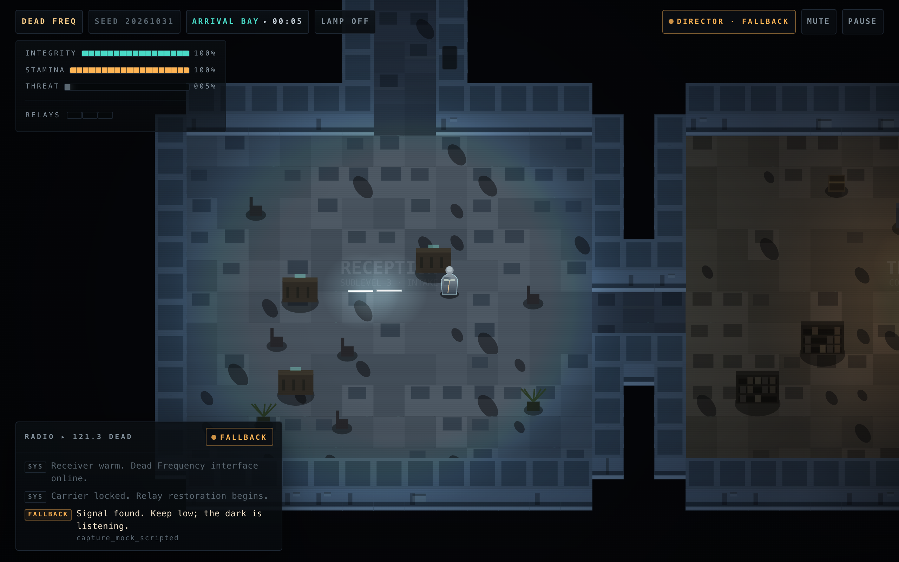
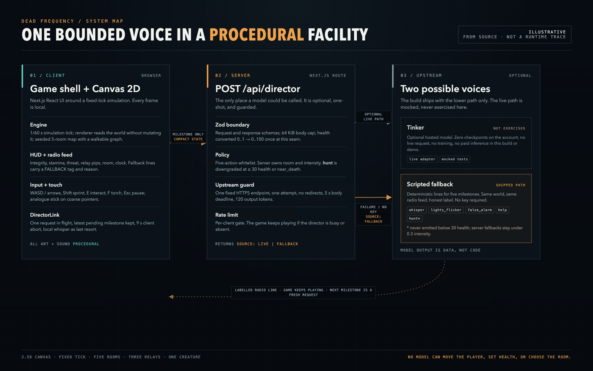

*This is a submission for the [Hacktoberfest Open-Source AI Challenge Week 4: Ghost in the Machine](https://dev.to/challenges/hacktoberfest-week4-2026-10-26).*

One of the strangest bugs in Dead Frequency was a ghost that had become too polite. The engine stores health from 0 to 1; the director API expects 0 to 100. At 75% health, the engine sent 0.75. The low-health guard compared that with 30, treated a healthy player as nearly dead, and downgraded every proposed hunt. Nothing crashed. The types were right, the units were wrong, and the tension disappeared at the boundary.

Dead Frequency is a short survival-horror game about an abandoned facility, three dead relays, and an emergency operator that should not still be answering. You restore the relays, avoid the creature, and decide whether to release the voice or shut it down. It is Next.js, TypeScript, and Canvas 2D, not 3D.

I wanted the AI to be a voice in the game, not the game itself. The shipped version makes no model calls. Every haunting event comes from a deterministic scripted fallback. The live Tinker path is tested against mocks, but it has never made a live request.



## What I Built

You start in the arrival bay of a facility whose emergency channel is still open. Three relays are dark, and the exit gate opens only when all three are restored. Between you and the relays is a creature that sees your flashlight from farther away and hears sprinting from farther than a walk.

The loop is small. Restore three relays, avoid the creature, reach the console, then choose. The arrival bay is a sanctuary where the creature's senses are masked. The rest of the facility is not.

The map is seeded, with five rooms, corridors, props, relays, and the console, all checked for solvability. The creature wakes after your second room or thirty seconds. It follows the walkable graph, so it can lose you but cannot walk through a wall or teleport.

The HUD shows integrity, stamina, threat, relay pips, room, and clock. Pause, death, choice, and ending screens are included; touch devices get a stick and buttons.


The scene is drawn and sounded in the browser: Canvas 2D passes for walls, floors, fixtures, relay glow, the creature, and grain; oscillators and filtered noise for audio. No remote art or sound files are downloaded. Audio starts after a click and can be muted.

## Demo

There is no hosted demo. I have not deployed this build, and a `render.yaml` file is not a live URL. It runs locally with two commands, no API key:

```bash
npm ci
npm run dev
```

Open `http://localhost:3000`. Without Tinker configuration, the director badge reads `fallback`, and the radio feed labels each scripted event as fallback.

[](assets/video/dead-frequency-demo.mp4)

The 46.4-second clip shows the title, movement, flashlight, one real relay restoration, the labelled fallback radio feed, and pause. It is not a full playthrough: the other two relays, a creature encounter, death, and both endings are not shown. Those progression outcomes have simulation coverage, not video evidence.

Every director request in this capture was intercepted with a scripted fallback response; no live model was called. The narration is an offline macOS `Samantha` voice. The quiet background bed is locally synthesized, not captured game audio. [English captions](assets/video/dead-frequency-demo.srt), the [transcript](assets/video/narration.txt), and [capture notes](assets/media-notes.md) are included.

| Paused | Narrow screen |
| --- | --- |
|  |  |

## Code

**Repository:** [puri-adityakumar/dead-frequency](https://github.com/puri-adityakumar/dead-frequency). It is currently private; this article remains an unpublished draft until the code and media have public access.

Start here:

- `src/shared/contracts.ts`: the game/director boundary, including health units.
- `src/game/sim.ts` and `src/game/render.ts`: simulation, creature, endings, and Canvas lighting.
- `src/game/lighting.ts`: the flashlight ray fan that stops at walls and sealed gates.
- `src/lib/director/policy.ts`: action whitelist, room/intensity ownership, low-health `hunt` downgrade.
- `src/lib/director/tinker.ts` and `src/components/directorClient.ts`: one-shot adapter, client timeout, labelled fallback.
- `scripts/smoke.mjs` and `scripts/lighting-smoke.mjs`: browser and lighting harnesses.

The code and this media package are in the private repository. I have not chosen a license or made a public release. There are no model weights or training code. The model's reply is parsed as JSON and mapped to an enum; it is data, not code.

## How I Built It

### The simulation is boring on purpose

The engine runs a fixed 1/60-second tick. The Canvas renderer reads the world without changing it, and the React HUD receives snapshots at most ten times a second. Movement and the creature use the same collision checks.

The map is seeded and tested for solvability. Rooms sit on a coarse grid, corridors connect them, and the exit gate is a full ring whose only crossing is the exit approach, so sealing it cannot strand a relay. The lighting check renders fourteen deterministic scenes: five rooms off and on, three relay-restored states, and the exit gate open. A directional probe also checks that the beam brightens the space ahead more than the space behind.



The latest lighting pass moved average floor luminance in those raw captures from roughly 15-26 to roughly 52-73 on a 0-255 canvas scale. It improved palettes and fixtures, added a player rim highlight, clipped the flashlight beam, and reduced stacked vignettes. The check asserts a minimum brightness, shadow detail, and contrast. That is a smoke threshold, not a visual review.

The [12-second lighting comparison](assets/video/lighting-demo.mp4) shows three labelled, isolated renderer fixtures before and after the pass. It is silent and is not gameplay footage.

### The director only speaks at milestones

The AI never runs in the frame loop. The engine emits five milestones: `start`, `room_enter`, `relay_restored`, `near_death`, and `exit_ready`. The browser sends a compact state with room, relays, health, flashlight, threat, milestone, and at most eight recent radio lines. There is no free-form prompt.

The client allows one request in flight, keeps only the latest pending milestone, and aborts after nine seconds. On failure, timeout, or invalid output, it generates its own radio line and marks it `fallback`. The game keeps playing.

On the server, Zod checks the request and response. The upstream call uses one fixed HTTPS endpoint, one attempt, no redirects, a five-second body deadline, a 64 KiB cap, and 120 output tokens. When live, the model returns `{"action": "...", "message": "..."}`. The action must be one of five: `whisper`, `lights_flicker`, `false_alarm`, `hunt`, `help`. The server chooses the room and intensity.

`hunt` is downgraded to `whisper` when health is at or below 30 or the milestone is `near_death`. The server's scripted fallbacks never use `hunt` and stay below 0.3 intensity. If the server itself is unreachable, the browser has a separate local whisper fallback. The model cannot directly change player health or position, teleport anyone, or permanently block progression. A hunt can temporarily sharpen the creature's senses and speed, so it still has gameplay consequences. The model cannot choose a URL or run generated code.



### The boundary bug

The health mismatch passed type checking because both values are numbers. Integration caught it when the server policy and engine snapshot disagreed about the scale. The fix was one conversion in `makeDirectorState` and tests that assert the server receives 75, not 0.75, while the HUD stays fractional. This was an integration and mocked-policy bug, not a failure observed from a live model.

A model boundary is not only a prompt. It is units, enums, ranges, timeouts, and a rule for when the answer never arrives. The most useful safety feature here is not a sentence in the system prompt. It is the finite action list and server-owned room and intensity.



### Parallel workstreams at max

I ran the build as parallel workstreams: simulation and Canvas renderer; React shell, HUD, touch, and Web Audio; director API and hardening; and an independent browser QA harness. Each owned separate files; the shared contract kept them aligned. I integrated and fixed the seams.

That split is why the health bug surfaced. The engine, UI, and server could each be correct alone and still disagree at the boundary. The QA workstream drove real Chrome with every director request intercepted, so no paid call could escape the browser.

## Why Does Open Innovation Matter?

Once dependencies are installed and the local server is running, the scripted game needs no account, model key, or external service. Next.js, React, TypeScript, Node, and Zod are open components; Canvas 2D and Web Audio are browser standards. There are no remote art assets, so the look is editable source.

OpenCode, an open-source coding-agent harness, was part of the actual build workflow: GLM workers built the renderer and UI, alongside Droid workers for the director and QA. That is a real use of an open agent harness, not evidence of live AI inside the game. The bounded runtime director is still an adapter tested with mocks.

The model side needs a more careful sentence. Tinker is a hosted service. The repository contains an adapter and a strict contract, not open model weights. The account had zero checkpoints, and I did not train or fine-tune anything. I can show the source, fallback, validation, and tests; I cannot show a model result that does not exist.

I have not chosen a license for the app yet. A public repository without a license is source-available, not open source. I will not call it open source until that file exists. The same care applies to the supplied Dark Sector reference: it informed the concept, but I did not copy its code because the archive has no explicit redistribution license. The reference is excluded from Git. Credit and permission are part of the work, not paperwork after it.

## The Ghost in the Machine

The theme usually points at a machine that escapes its box. I wanted the opposite: a ghost that is present, responsive, and bounded.

The director can whisper, flicker lights, send the creature toward a false alarm, sharpen a hunt, or help you catch your breath. It cannot rewrite the rules. The server owns room and intensity. The client owns the timeout. The engine owns damage and endings. The final choice belongs to the player.

The machine is haunted, but it has a fuse box. The ghost can make the facility feel less predictable without becoming the author of the run. When no model is present, the fallback still speaks in the same world, with an honest `FALLBACK` tag instead of a fake `LIVE` badge.

## Limits

- **No live inference.** The Tinker account had zero checkpoints. No real model call, training, or paid inference happened; the shipped game uses fallback.
- **No fine-tune result.** No training, held-out evaluation, or baseline comparison. I am not claiming the Tinker fine-tuning category.
- **No hosted demo or deployment.** The app runs locally. `render.yaml` is a blueprint, not a deployment. I am not claiming the Render category.
- **No public release or license yet.** The linked repository is private, and the app is not yet licensed open source. Repository packaging and documentation updates are dated November 1, 2026; the README records their scope.
- **Tests are split.** 56 unit tests, TypeScript, production build, fourteen deterministic lighting scenes, and 27 post-lighting Chrome smoke checks pass. The browser suite has no failures, warnings, skips, or blocked checks. Relay, death, and both endings have simulation coverage, but the short demo is not a full playthrough.
- **Scope.** One creature, one facility, five rooms, no save system. The browser harness does not assert audio quality.
- **AI is optional.** The live path is exercised with mocks, not a real checkpoint. Missing config, a busy gate, upstream error, or invalid output all produce the labelled fallback.

## Prize Categories

I am entering the Ghost in the Machine challenge. I am not entering the Tinker fine-tuning category, because I have no fine-tune or measured improvement. I am not entering the Render category, because I have not deployed. If those change before submission, I will update this section and demo rather than quietly widening a claim.
